# Manual de usuario de Zest

Zest es una app de recetas: publicás tus recetas con ingredientes, pasos y foto, buscás recetas de otros usuarios, las guardás en colecciones y planificás qué cocinar cada día de la semana.

- **Dirección de la app:** https://zest-frontend-five.vercel.app
- **Versión descrita:** la que está en producción desde el 11/11/2026 (rama `main` de `proyecto-zest/zest`, commit `19ee689`). Las capturas son de esa versión, tomadas el 12/11/2026.
- **Idioma de la app:** las pantallas están en inglés. En este manual los botones y textos aparecen entre comillas tal como se ven en la app, por ejemplo "Publish".

> Funciona en computadora y en celular. En celular, el menú de arriba se reemplaza por el ícono ☰, que abre las mismas opciones.

## Índice

1. [Registrarse e iniciar sesión](#1-registrarse-e-iniciar-sesión)
2. [Moverse por la app](#2-moverse-por-la-app)
3. [Buscar recetas](#3-buscar-recetas)
4. [Ver una receta](#4-ver-una-receta)
5. [Crear una receta](#5-crear-una-receta)
6. [Editar y eliminar tus recetas](#6-editar-y-eliminar-tus-recetas)
7. [Colecciones](#7-colecciones)
8. [Perfil](#8-perfil)
9. [Planificador semanal](#9-planificador-semanal)
10. [Problemas frecuentes](#10-problemas-frecuentes)

---

## 1. Registrarse e iniciar sesión

Para usar Zest necesitás una cuenta. Sin sesión iniciada solo se ve la pantalla de ingreso.

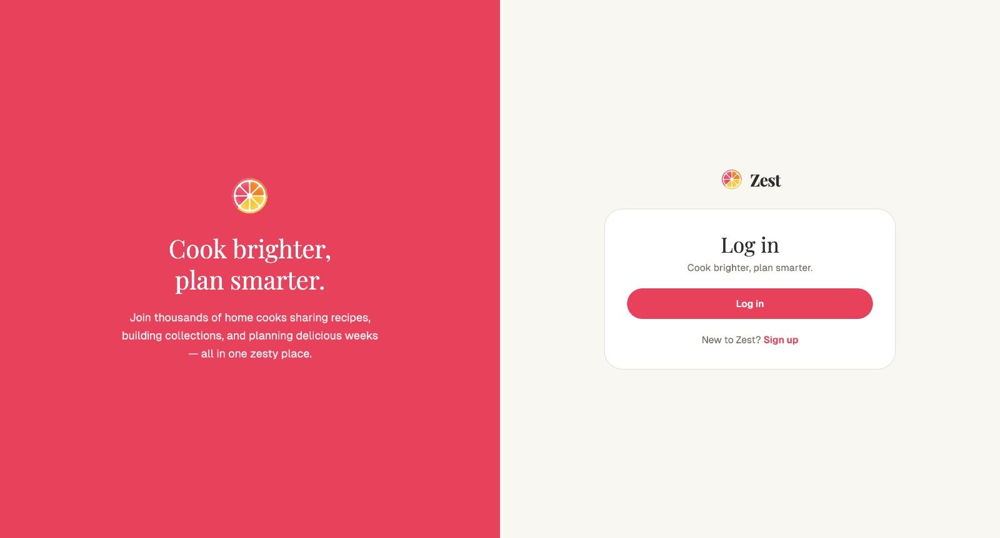

Las cuentas y contraseñas las maneja **Auth0**, un servicio externo. Zest nunca ve ni guarda tu contraseña. Por eso, al registrarte o ingresar, la app te lleva un momento a una pantalla de Auth0 ("Welcome") y después te devuelve a Zest.

### Crear una cuenta

1. Entrá a https://zest-frontend-five.vercel.app.
2. Abajo del botón "Log in", hacé clic en "Sign up" ("New to Zest? Sign up") y después en el botón "Sign up".
3. En la pantalla de Auth0, completá "Email address" y "Password" y hacé clic en "Continue".
   También podés usar tu cuenta de Google con "Continue with Google".
4. Volvés a Zest con la sesión iniciada y ves el feed.

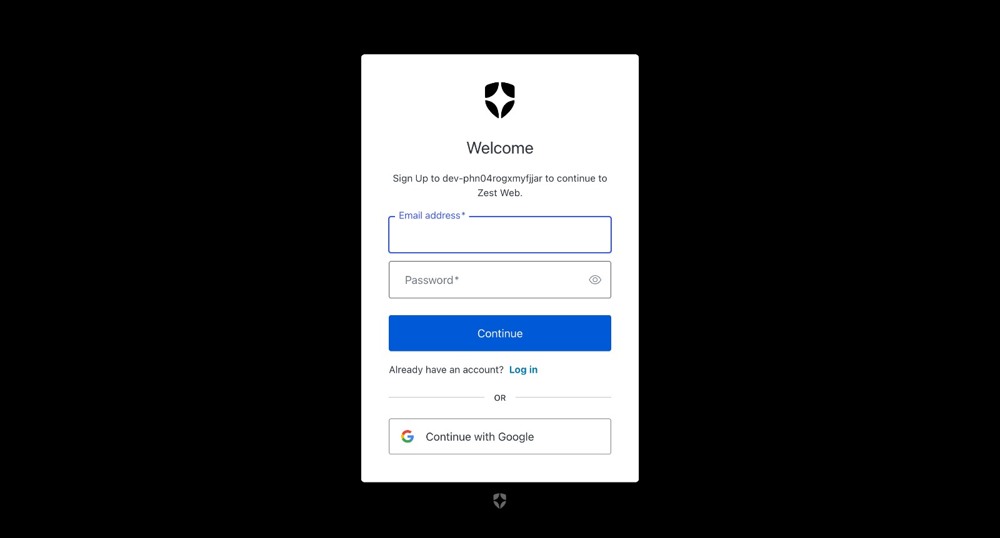

### Iniciar sesión

1. En la pantalla de Zest, hacé clic en "Log in".
2. En la pantalla de Auth0, ingresá tu email y contraseña y hacé clic en "Continue", o usá "Continue with Google".
3. Volvés a Zest con la sesión iniciada.

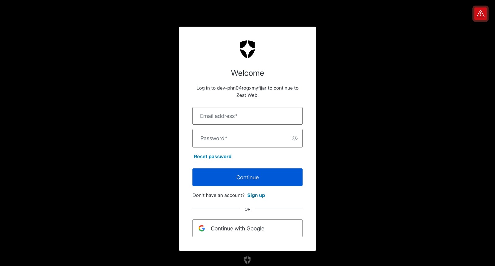

¿Te olvidaste la contraseña? En esa misma pantalla de Auth0, hacé clic en "Reset password" y seguí el email que te llega.

### Cerrar sesión

Hacé clic en tu avatar (el círculo con tu inicial, arriba a la derecha) y elegí "Log out".

---

## 2. Moverse por la app

La barra superior está en todas las pantallas:

| Elemento | Qué hace |
|---|---|
| Logo **Zest** | Vuelve al feed |
| "Feed" | Todas las recetas publicadas, de todos los usuarios |
| "Collections" | Tus colecciones |
| "Meal Planner" | Tu planificador semanal |
| "+ New recipe" | Abre el formulario para crear una receta |
| Tu avatar | Menú con "Edit profile" (tu perfil) y "Log out" |

---

## 3. Buscar recetas

El feed ("Discover") muestra todas las recetas en páginas. Arriba a la derecha dice cuántas hay. Cada tarjeta muestra la foto, el tiempo, la dificultad, la categoría, el título y el autor. Usá las flechas de abajo para cambiar de página.

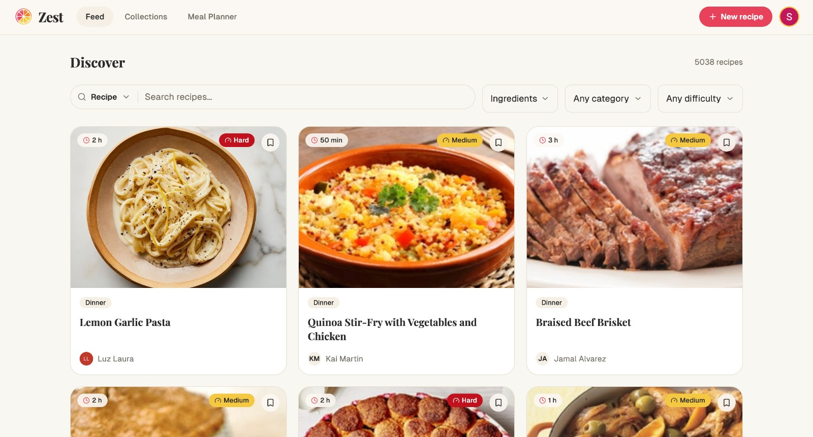

### Buscar por nombre o por autor

1. En la barra de búsqueda, elegí el criterio en el desplegable de la izquierda: "Recipe" (nombre de la receta) o "Author" (nombre de quien la publicó).
2. Escribí el texto. Los resultados se actualizan solos mientras escribís y el contador cambia.
3. Abajo de la barra aparece un chip con la búsqueda activa, por ejemplo "Recipe: Beef". La ✕ del chip la saca.

No hace falta escribir tildes: "limon" encuentra "Limón".

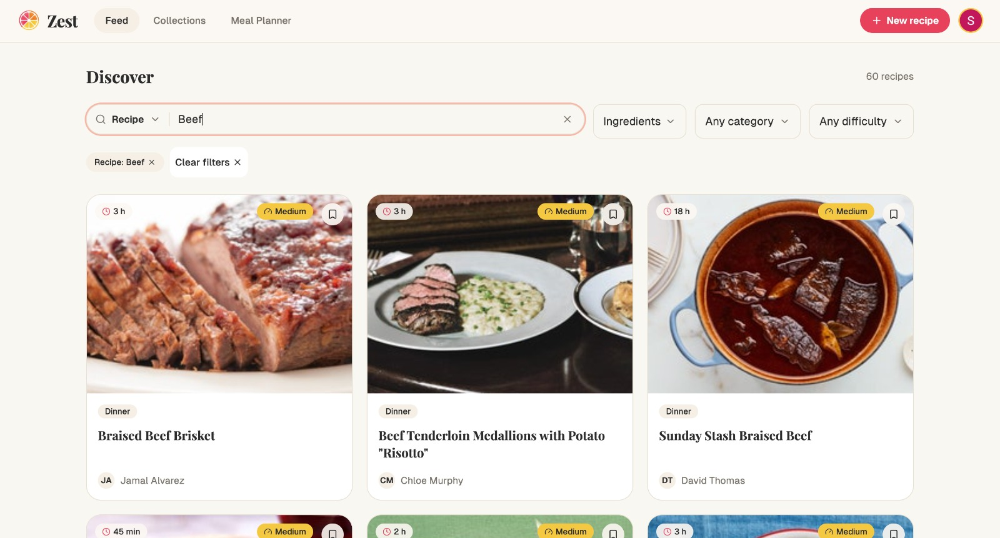

### Filtrar

Al lado del buscador hay tres filtros que se pueden combinar con la búsqueda:

| Filtro | Opciones |
|---|---|
| "Ingredients" | Uno o varios ingredientes del catálogo |
| "Any category" | Breakfast, lunch, dinner, dessert, etc. |
| "Any difficulty" | Easy, Medium, Hard |

En la captura, la búsqueda "Beef" está combinada con la dificultad "Hard". Para sacar todo de una vez, usá "Clear filters".

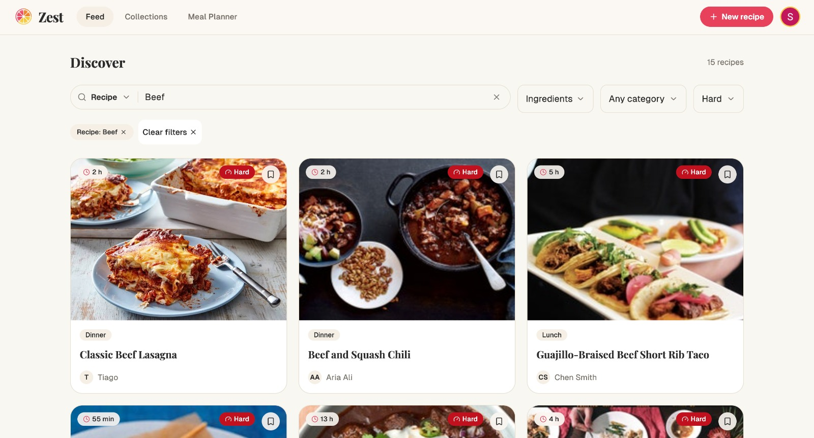

Si ninguna receta cumple los filtros, aparece "No recipes match these filters.". Sacá algún filtro para ver más resultados.

> Los filtros quedan en la dirección de la página: si copiás el link y lo compartís, la otra persona ve la misma búsqueda.

---

## 4. Ver una receta

Hacé clic en cualquier tarjeta. La página de la receta muestra:

- La foto, el título, la descripción y el autor ("Recipe author"). Hacé clic en el autor para ver su perfil.
- La categoría y tres datos: tiempo ("Time"), dificultad ("Level") y porciones ("Servings").
- Dos botones: "Save to collection" (ver [Colecciones](#7-colecciones)) y "Add to planner" (ver [Planificador](#9-planificador-semanal)).
- Los ingredientes ("Ingredients") con cantidad y unidad.
- Los pasos ("Instructions"), numerados.

"← Back" vuelve a donde estabas.

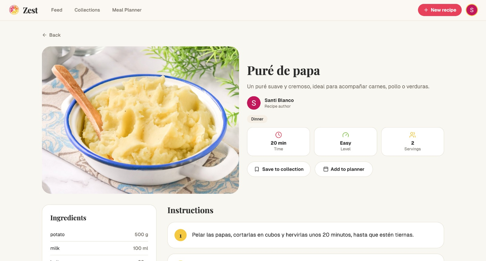

---

## 5. Crear una receta

1. Hacé clic en "+ New recipe". Se abre "Create a recipe".
2. **Foto de portada** (opcional): hacé clic en "Add a cover photo" y elegí una imagen JPEG, PNG o WebP de hasta 5 MB. Para cambiarla, sacala con la ✕ de la esquina y subí otra.
3. **Datos de la receta:**

   | Campo | Reglas |
   |---|---|
   | "Recipe title" | Obligatorio, hasta 100 caracteres |
   | "Description" | Obligatoria, hasta 500 caracteres |
   | "Category" | Obligatoria |
   | "Servings" | Obligatorio, de 1 a 100 |
   | "Time" + "Time unit" | Obligatorios. En minutos, hasta 59; para más tiempo, cambiá la unidad a horas (hasta 23) |
   | "Difficulty" | Obligatoria |

4. **Ingredientes ("Ingredients"):** por cada ingrediente, elegilo de la lista, escribí la cantidad ("Amount", hasta 12 caracteres, por ejemplo `2` o `1/2`) y elegí la unidad ("Unit"): gramos, tazas, cucharadas, unidades, "a gusto", etc. Con "+ Add ingredient" agregás otra fila y con la ✕ la sacás. Hace falta al menos uno.
5. **Pasos ("Instructions"):** escribí cada paso en su fila. Abajo de cada uno se ve cuántos caracteres te quedan (máximo 500). Con "+ Add step" agregás otro. Hace falta al menos uno.
6. Hacé clic en "Publish". Si subiste foto, primero vas a ver "Uploading image…" y después "Publishing…".
7. Cuando termina, la receta ya aparece en el feed para todos los usuarios.

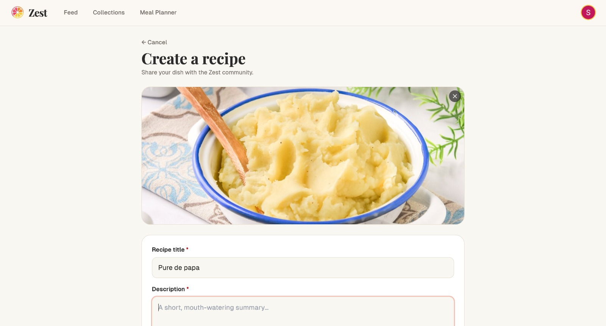

Si falta algo, arriba aparece "Please fix the following" con la lista de lo que hay que corregir (por ejemplo, "Title is required." o "Add at least one step."), y el botón "Publish" queda deshabilitado hasta que lo arregles.

"Cancel" (arriba o al lado de "Publish") vuelve al feed sin guardar nada.

---

## 6. Editar y eliminar tus recetas

Solo podés editar o eliminar recetas que publicaste vos. En tus tarjetas aparecen dos íconos extra abajo a la derecha de la foto: lápiz (editar) y tacho (eliminar). Se ven en la captura de tu perfil, en la [sección 8](#8-perfil).

### Editar

1. Hacé clic en el lápiz. Se abre "Edit recipe" con los datos cargados.
2. Cambiá lo que quieras: es el mismo formulario y tiene las mismas reglas que al crear.
3. Hacé clic en "Save changes" y confirmá en el cartel "Save changes?".

"Cancel" vuelve a la receta sin guardar.

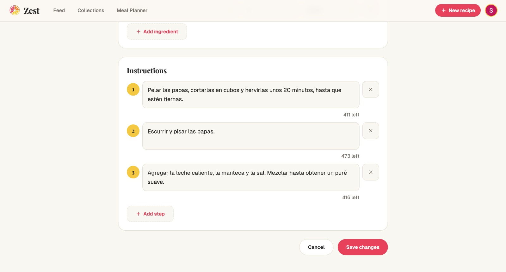

### Eliminar

1. Hacé clic en el tacho.
2. Confirmá en el cartel "Delete recipe?" con "Delete".

**No se puede deshacer.** La receta desaparece del feed, de las colecciones donde estaba guardada y del planificador.

---

## 7. Colecciones

Una colección es una lista de recetas con nombre y color, por ejemplo "Mis Favoritas" o "Recetas gym". Puede tener recetas tuyas y de otros usuarios. **Guardar una receta en Zest es siempre agregarla a una colección.**

En "Collections" ("My Collections") ves todas tus colecciones, con la cantidad de recetas de cada una.

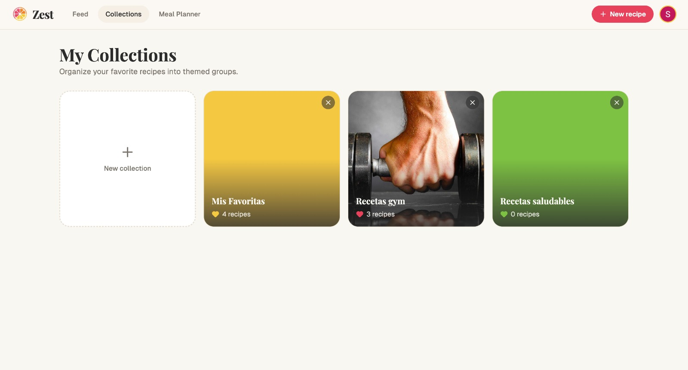

### Crear una colección

1. En "My Collections", hacé clic en "+ New collection".
2. Escribí el nombre ("Collection name") y elegí un color ("Accent color").
3. Confirmá. La colección aparece en la lista.

### Guardar una receta en una colección

1. Hacé clic en el ícono de marcador de una tarjeta, o en "Save to collection" en el detalle de la receta.
2. Se abre la lista de tus colecciones. Hacé clic en una para agregar la receta y otra vez para sacarla.
3. Si todavía no tenés la colección, creala desde ahí mismo con "New collection".

### Ver y completar una colección

1. En "My Collections", hacé clic en una colección. Ves el nombre, la cantidad de recetas ("4 recipes · curated by you") y sus tarjetas.
2. Para volver, usá "← All collections".

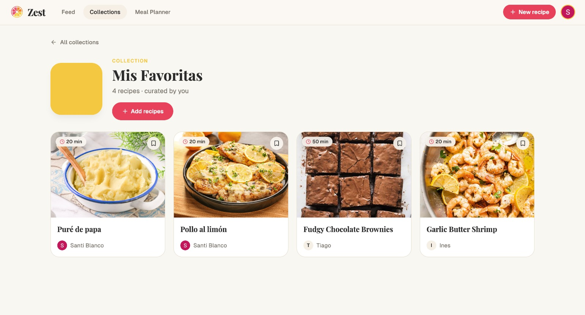

Para sumar recetas sin salir de la colección:

1. Hacé clic en "+ Add recipes".
2. Buscá por nombre ("Name") o por ingrediente y, si querés, filtrá por dificultad ("All", "Easy", "Medium", "Hard").
3. Hacé clic en el "+" de cada receta que quieras agregar.
4. Cerrá la ventana con la ✕.

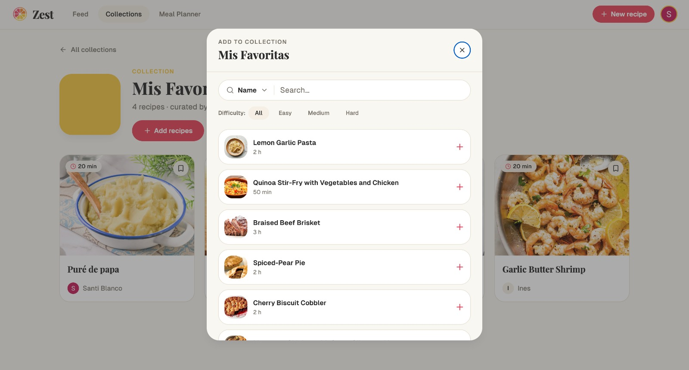

### Eliminar una colección

1. En "My Collections", hacé clic en la ✕ de la esquina de la colección.
2. Confirmá en "Delete collection?" con "Delete".

Se borra la colección, **pero no las recetas que tenía**. No se puede deshacer.

---

## 8. Perfil

Abrí tu avatar y elegí "Edit profile". El perfil tiene tres pestañas:

| Pestaña | Qué muestra |
|---|---|
| "My recipes" | Las recetas que publicaste, con los íconos de editar (lápiz) y eliminar (tacho) |
| "Collections" | Tus colecciones |
| "Settings" | Tu nombre y el cambio de contraseña |

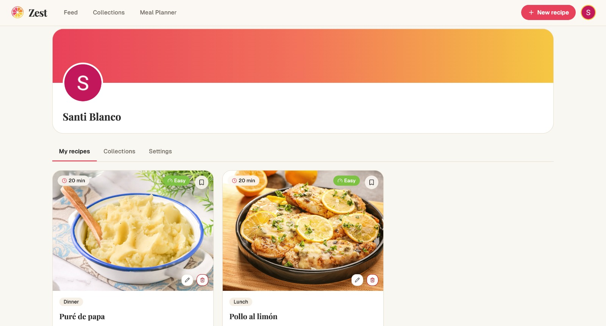

### Cambiar tu nombre

En "Settings", editá "Name" y hacé clic en "Save name". Si sale bien, aparece "Your name was updated.". El nombre no puede quedar vacío.

### Cambiar tu contraseña

En "Settings", hacé clic en "Change password". Te llega un email a tu dirección para elegir una contraseña nueva ("We sent a password reset email to …").

### Ver el perfil de otro usuario

Hacé clic en el nombre del autor en una tarjeta o en una receta. Ves su nombre y sus recetas ("Recipes"). No podés editarlas, pero sí guardarlas en tus colecciones.

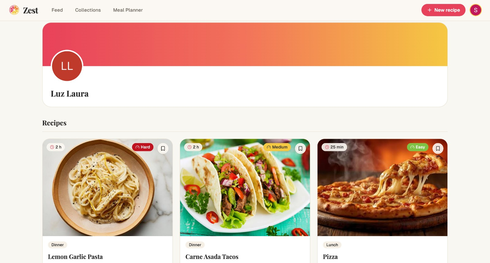

---

## 9. Planificador semanal

En "Meal Planner" organizás qué vas a cocinar cada día ("Plan your week, one delicious day at a time.").

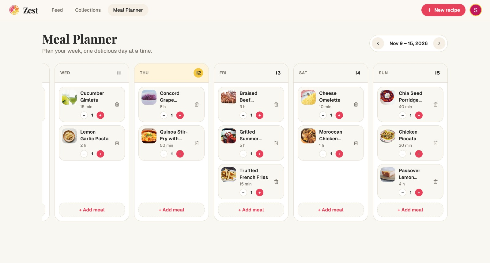

### Ver la semana

- Cada columna es un día, con el nombre y el número. El día de hoy aparece resaltado.
- Arriba a la derecha está la semana que estás viendo (por ejemplo "Nov 9 – 15, 2026"). Con las flechas ‹ › pasás a la semana anterior o a la siguiente.
- Cada comida muestra la foto, el nombre de la receta, el tiempo de preparación y la cantidad.

### Agregar una comida desde el planificador

1. En el día que quieras, hacé clic en "+ Add meal". Se abre "Add a meal" con la fecha elegida (por ejemplo "Saturday, Nov 14").
2. Elegí de dónde sacar la receta:
   - "Discover": todas las recetas. Podés buscar por nombre y filtrar por dificultad.
   - "Collections": las recetas de tus colecciones.
3. Hacé clic en el "+" de la receta. Se agrega a ese día con cantidad 1.

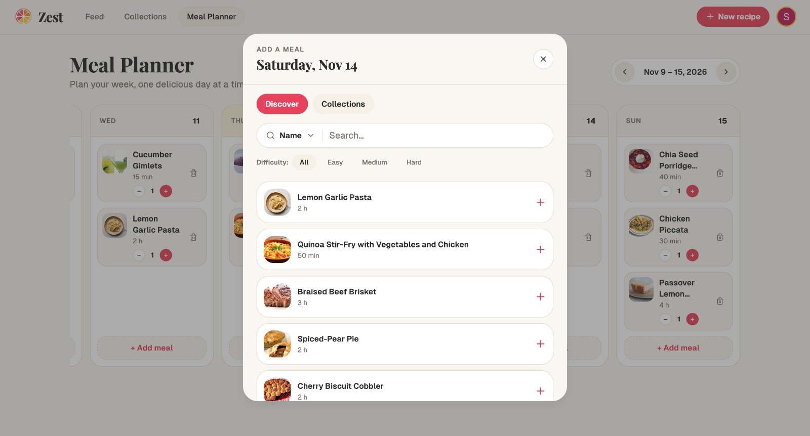

### Agregar una receta desde su página ("Add to planner")

1. En el detalle de una receta, hacé clic en "Add to planner".
2. Se abre un calendario. Elegí el día ("Today" marca hoy).
3. La receta se agrega a ese día con cantidad 1 y aparece un aviso de confirmación.

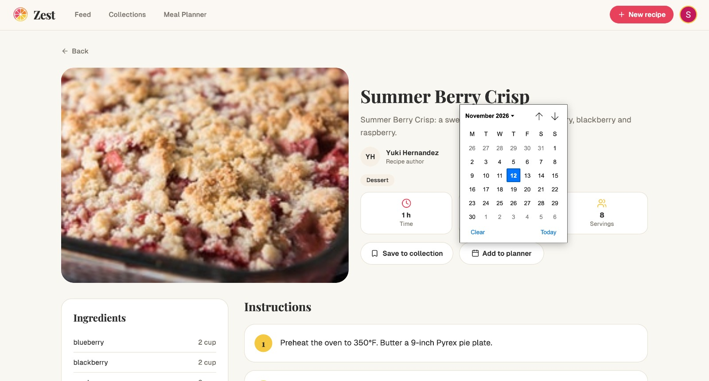

Si agregás una receta que ya estaba ese día, no se duplica: se le suma 1 a la cantidad.

### Cambiar la cantidad

Debajo de cada comida está el selector de cantidad ("−", el número, "+"). La cantidad va de 1 a 100. Si apretás "−" cuando está en 1, Zest te pregunta si querés quitar la comida.

### Quitar una comida

Hacé clic en el tacho de la comida y confirmá con "Remove".

---

## 10. Problemas frecuentes

| Problema | Qué hacer |
|---|---|
| La app me manda a "Log in" | Tu sesión venció. Volvé a iniciar sesión. |
| Aparece "Couldn't load recipes" o un error parecido | Esperá unos segundos y hacé clic en "Try again" o recargá la página. Si sigue, avisale al equipo. |
| No puedo subir la foto | Revisá que sea JPEG, PNG o WebP y pese menos de 5 MB. |
| "Publish" está gris | Falta completar o corregir algún campo. Mirá la lista "Please fix the following". |
| No veo el lápiz para editar una receta | Solo aparece en las recetas que publicaste vos. |
| No encuentro una receta que guardé | Las recetas guardadas están dentro de tus colecciones, en "Collections". |
| No me llega el email para cambiar la contraseña | Revisá la carpeta de spam. El email lo manda Auth0. |
| "Add to planner" no hace nada | Tenés que elegir un día en el calendario que se abre. Si aparece "Couldn't add to planner", probá de nuevo. |
